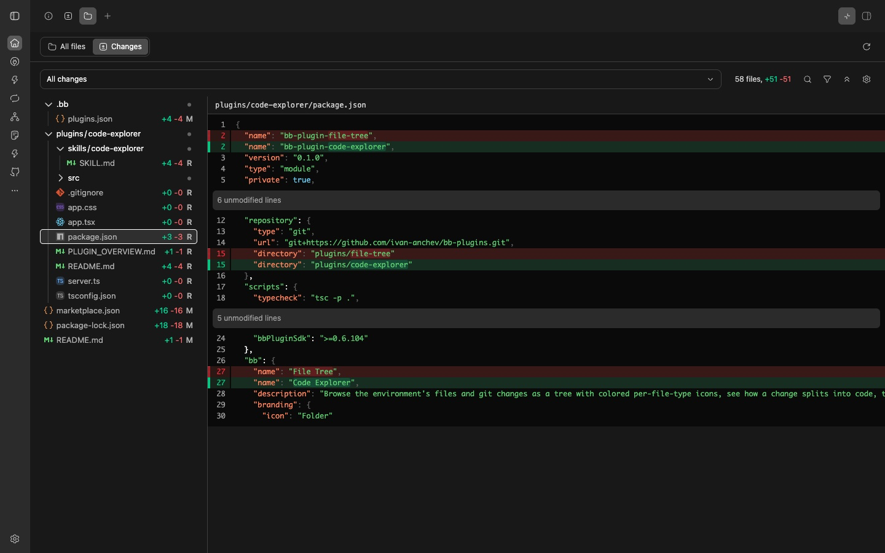
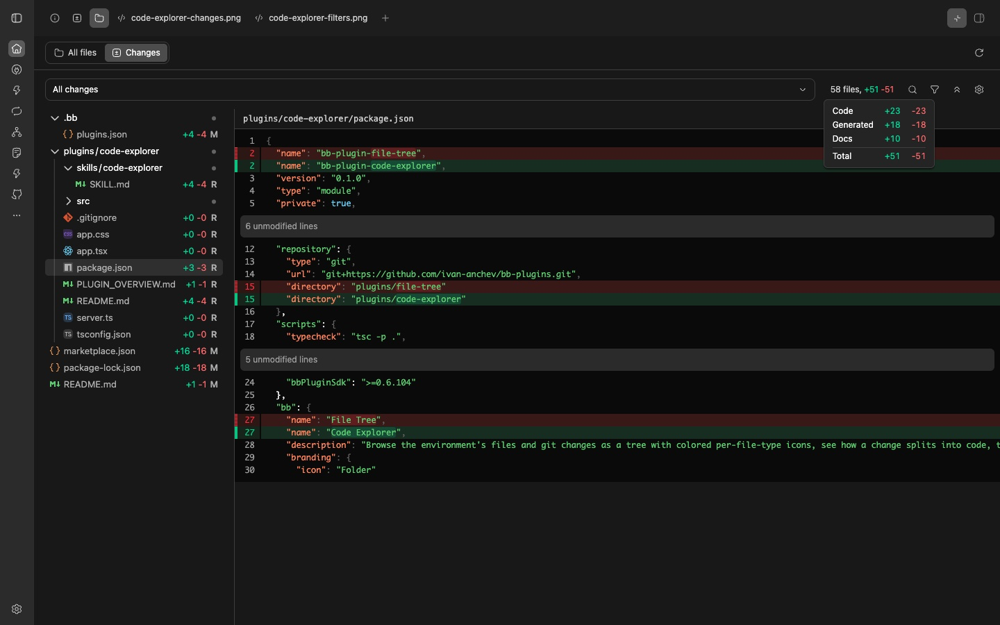
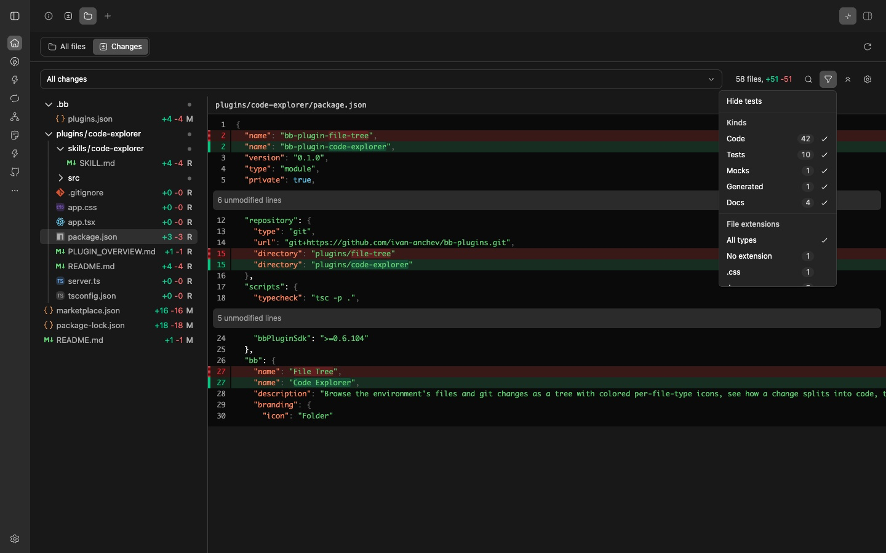

# Code Explorer

A **Files** tab in the thread side panel that shows the environment's files,
and its git changes, as a tree with colored per-file-type icons. Clicking a file
shows its contents, or its diff in Changes, beside the tree in the same tab. See
`PLUGIN_OVERVIEW.md` for the user-facing description and
`skills/code-explorer/SKILL.md` for what the tab shows.

## Install

```sh
bb marketplace add git:github.com/ivan-anchev/bb-plugins@main
bb plugin install code-explorer@ivan-anchev
```

If you have the old File Tree plugin installed, remove it with
`bb plugin remove file-tree` to avoid a second Files tab.

## Screenshots

Browse changed files and read their diffs beside the tree.



Hover or focus the totals to see added and deleted lines by change kind.



Filter by change kind or file type, or hide tests and mocks together.



## Layout

| Path | What it is |
| --- | --- |
| `app.tsx` | Registers the fixed `files` tab in thread context. |
| `app.css` | Maps the tree's theme and git status colors to bb's host tokens. |
| `server.ts` | Minimal backend entry; bb requires one. |
| `src/files-tab.tsx` | The tab: no-environment notice and the All files / Changes switch. |
| `src/all-files-view.tsx` | All files: `useSdk().environments.paths` as a tree, with the selected file's contents beside it. |
| `src/changes-view.tsx` | Changes: the `bb--git` `status` and `files` reads, refresh, and the loading and error states around the changes tree. |
| `src/changes/` | The Changes header and tree: target options, `N files, +A -D` stats and their per-kind breakdown, the path, type and kind filters (pure and unit tested), the remembered header controls, and the tree beside the selected file's diff. |
| `src/changes/change-kind.ts` | Sorts a changed path into a change kind: code, tests, mocks, generated or docs. Self-contained, so other views can reuse it. Unit tested. |
| `src/changes/header/` | The header bb's Diff tab draws: target dropdown, stats line with its kind breakdown on hover and focus, filename search, filter menu, collapse/expand all, and diff settings. |
| `src/file-viewer.tsx` | A file's contents in bb's `experimental_SourceCode`, read with `useSdk().files.read`. |
| `src/diff-viewer.tsx` | A changed file's diff in bb's `experimental_Diff`, from `files` `initialPatches` or the keyed `patches` read, drawn split or unified, wrapped or scrolled. |
| `src/git.ts` | The slice of the `bb--git` RPC contract this plugin reads. |
| `src/viewer-input.ts` | Pure choice of what the viewer shows: a patch, a patch key to fetch, source text, or a notice. Unit tested. |
| `src/tree-input.ts` | Pure mapping from bb data to `@pierre/trees` input: paths, git status, icons, per-row `+A -D` decorations, and distinct tree paths for a changed file that stands where a changed directory is. Unit tested. |
| `src/tree-view.tsx` | The `@pierre/trees` model and view: density, path sync, row decorations, the selected row, click to select. |
| `src/tree-expansion.ts` | Collapse and expand every folder, and whether any is open. Unit tested. |
| `src/split/` | The resizable tree-beside-viewer layout: a divider you drag or move with the arrow keys, with the sizes remembered. The clamping is unit tested. |
| `src/ui/` | Small controls in bb token classes: icon button, dropdown menu (bb's shared Radix menu), and a hover and focus tooltip. |
| `src/hooks/` | React hooks: environment paths, file contents, refetch on show, per-environment remembered state. |
| `src/chrome.tsx` | Toolbar, segmented control, notices, and the viewer frame in bb token classes. |

The tree and its icons are [`@pierre/trees`](https://www.npmjs.com/package/@pierre/trees)
(Apache-2.0) with its built-in `complete` colored icon set, the same component
T3 Code uses. The path filter matches with [`picomatch`](https://www.npmjs.com/package/picomatch)
(MIT), as bb's Diff tab does. The change kind rules in `src/changes/change-kind.ts`
are ported from [T3 Code](https://github.com/pingdotgg/t3code)'s
`packages/shared/src/changedFileKind.ts` (MIT, © 2026 T3 Tools Inc.), as is
the layout of the kind breakdown.

## Develop

From the repository root:

```sh
npm install
npm run check
bb plugin install ./plugins/code-explorer
bb plugin dev plugins/code-explorer
```

`npm test` in this directory runs the unit tests with `node --test`.
